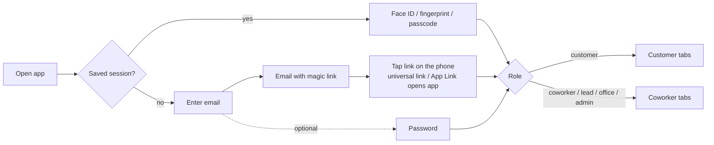
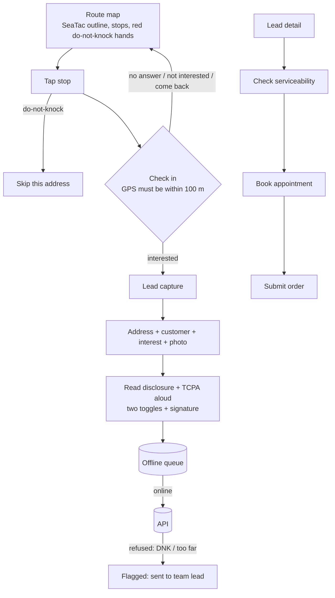

# 03 · App Flow

## Sign-in (everyone)

Desktop staff click the same link and land in the **admin console** (`/auth/verify` → `/#magic=…`).

## Customer: 3 tabs

| Tab | Screen | Actions |
|---|---|---|
| **My order** | Order cards: status, install date, "Invoice due" badge | Tap → **Order timeline**: Order received → Install scheduled → Installed → Activated → Feedback available. Plan + "AT&T bills separately" notice |
| **Invoices** | List with balance, due date, status | Tap → **Invoice**: amount, paid, balance, terms, payments → **Pay with card** or **Pay from bank (ACH)** → Stripe sheet → back to invoice |
| **Feedback** | Locked until activation | 4 star ratings + comment (≤1,000) + optional photo → submit → "pending" until moderated. Shows public average rating |

Push notifications deep-link into the right tab (`screen`: timeline / invoice / feedback).

## Coworker: 3 tabs + banner

| Tab | Screens |
|---|---|
| **Route** | Map, route picker, progress "3 of 12 doors · Permit …", sync chip (offline / queued / flagged) |
| **Leads** | "Waiting to sync" section (with flagged items + reason), my leads → lead detail (serviceability, appointment, order) |
| **Me** | 90-day sales stats, my pulse trend chart, crew average (hidden until 3+ answers), kudos, "Give kudos" |
| Banner | "Weekly check-in: 3 quick questions" → pulse sheet (anonymous toggle, optional named follow-up) |

## Admin console (web)

Sidebar sections, shown by role:

| Section | Lead | Office | Admin | What happens |
|---|---|---|---|---|
| Overview | ✓ | ✓ | ✓ | Success-metric tiles with targets |
| Review queue | ✓ | | ✓ | Approve/deny out-of-area addresses; resolve sync conflicts |
| Routes | ✓ | | ✓ | Paste addresses → geocode → DNK removed → assign rep + date + permit |
| Do-not-knock | ✓ | ✓ | ✓ | Add (also pulls address off future routes); admin can remove |
| Leads | ✓ (crew) | ✓ | ✓ | Search + filter |
| Orders | ✓ (crew) | ✓ | ✓ | Order dialog: update each timeline stage, notes, AT&T ref, cancel, create invoice |
| Invoices | | ✓ | ✓ | List, send drafts |
| Feedback | ✓ | | ✓ | Approve / reject with internal note |
| Scorecards | | | ✓ | Crew aggregates, people sales, named pulse responses |
| Commissions | | | ✓ | Reconcile actual vs estimate (required before closing an order) |
| Catalog & coverage | | ✓ | ✓ | Rate card items, ZIP/street coverage |
| Users & crews | | | ✓ | Add users, deactivate (revokes sessions) |
| Settings | ✓ (view) | | ✓ | Permit ref, default terms, consent version, geofence, stale-lead days, service-area polygon |
| Audit log | | | ✓ | Every admin action |

## When a rule stops the action

The server enforces these; the apps show the message and, for offline captures, keep the record as a flagged item for a team lead.

| What the rep did | Server answer | What happens next |
|---|---|---|
| Checked in or captured a lead at a do-not-knock address | 403 `do_not_knock` | Rep sees "Leave the property". A row appears in **Admin → Review queue → Offline sync conflicts** |
| Checked in more than 100 m from the address (setting `geofence_meters`) | 422 `not_at_property` | Rep sees the distance and must check in at the door. Same review-queue row |
| Saved a lead without both consent toggles | 422 `tcpa_consent_required` / `disclosure_ack_required` | Save stays blocked; nothing is stored |
| Captured a lead at an address outside SeaTac | Saved, flagged `out_of_area` | Lead appears in **Review queue → Addresses outside SeaTac**; a team lead approves or denies it |

A team lead resolves a conflict row in the Review queue; resolving it does not recreate the refused record.

## Notifications and links

| | iPhone | Android |
|---|---|---|
| Sign-in link | Universal link | App Link, or `dealerdoor://auth?token=…` |
| Push (install update, invoice reminder, "How did we do?") | Yes. Tapping opens the matching tab: timeline, invoice or feedback | **Not yet.** Needs a Firebase project. Customers get email instead. Planned: see [09-REMAINING-WORK.md](09-REMAINING-WORK.md) |

## Customer cancellation

Today only office or admin can cancel an order (Admin → Orders → Cancel order, reason required), and never after it is activated. Customers cannot cancel from the app yet. A request step inside the 3-business-day window is planned, pending counsel's wording.

## Exports and privacy

- **Export CSV** buttons appear on Leads, Orders and Invoices for office and admin, and on Commissions for admin only. Each download is written to the audit log.
- The privacy policy is public at `/privacy` and linked from the console sign-in page.

## Order stage rules

- Stages complete **in order**. "Invoice paid" may complete any time (auto-completes when all invoices are paid) but must be done before **Closed**.
- **Install scheduled** needs a date/time. **Activated** unlocks customer feedback and sends the "How did we do?" push.
- **Closed** is admin-only and requires a reconciled commission.
