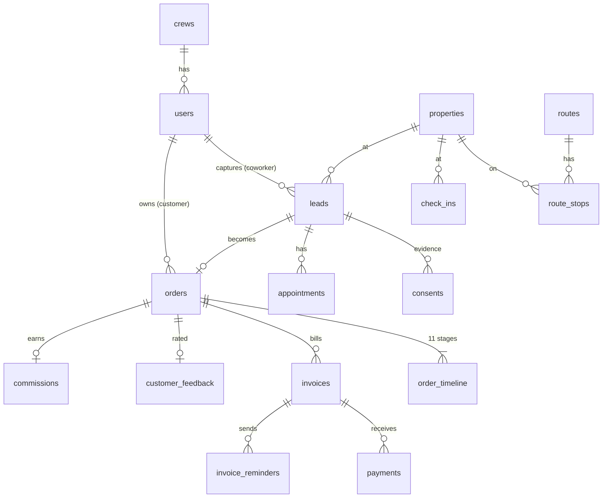

# 05 · Backend Schema

Source of truth: [`worker/migrations/0001_init.sql`](../worker/migrations/0001_init.sql) (tables) and [`0002_seed.sql`](../worker/migrations/0002_seed.sql) (reference data). Demo users: [`worker/seed/dev.sql`](../worker/seed/dev.sql), local only.

## Tables

| Group | Table | Purpose |
|---|---|---|
| **People & auth** | `users` | Everyone. `role` ∈ customer, coworker, lead, office, admin. `crew_id`, `locale` (en/es), optional `password_hash` (PBKDF2) |
| | `crews` | Coworker teams with a lead |
| | `magic_links` | Hashed one-time sign-in tokens, 15 min |
| | `sessions` | Hashed rotating refresh tokens, 30 days |
| | `devices` | APNs tokens per user |
| **Territory** | `service_area` | SeaTac GeoJSON polygon (approximate until replaced) |
| | `properties` | One row per address: coords, `seatac_valid`, `needs_review`, `do_not_knock` + reason |
| | `routes` / `route_stops` | Assigned canvass routes with permit ref; stops point at properties |
| | `check_ins` | Geo-verified door knocks: device coords, distance from property, outcome |
| | `settings` | Permit ref, default terms, consent version, geofence meters, stale-lead days |
| **Sales** | `consent_texts` | Versioned TCPA + door-to-door disclosure text, en/es |
| | `leads` | Interest captured; status new → interested → appointment → order / not_serviceable / closed |
| | `consents` | **Immutable** evidence: kind, text version, timestamp, rep, property, address snapshot, signature |
| | `appointments` | Install/consult windows |
| | `catalog_items` | Internet tiers, TV, bundles, add-ons; promo snapshot fields; required tech; commission |
| | `coverage` | Serviceability by ZIP (+ optional street prefix) and technology |
| | `orders` | Bundle pricing snapshot, install dates, AT&T order ref, status |
| | `order_timeline` | 11 stages per order with internal + customer notes |
| | `commissions` | Estimate at order time; admin reconciles actual |
| **Money** | `invoices` | Dealer-billed only. Terms ∈ {0, 15, 30, 45, 60}; status draft → sent → viewed → partial → paid / overdue |
| | `payments` | Processor payment ids (unique), method card/ach, status |
| | `invoice_reminders` | One row per invoice per reminder kind (T-3, T0, T+7, T+30) so nothing is sent twice |
| **Feedback** | `customer_feedback` | 4 ratings, comment ≤1,000 (DB-enforced), photo key, moderation status, `admin_note` (never returned to customers). One per order |
| | `pulse_responses` | Weekly 3-question pulse. `user_hash` = HMAC(secret, user id); `user_id` only when the coworker opts in |
| | `kudos` | Peer kudos; DB requires an order **or** a route and blocks self-kudos |
| **Operations** | `audit_log` | Admin actions: feedback moderation, invoice create/edit/send, timeline changes, order cancel, DNK changes, route assignment, commissions, settings, users |
| | `sync_conflicts` | Offline captures the server refused (do-not-knock, too far from the door) |

## Relationships

## Changes from the spec's section 7 model (and why)

| Spec | Built | Why |
|---|---|---|
| `role IN (customer, coworker, admin)` | adds `lead`, `office` | Spec section 3 describes team leads and back office with different permissions |
| `pulse_responses.user_id` always set | `user_hash` always, `user_id` only on opt-in | Makes "anonymous by default" real while still allowing own trend + one vote per week |
| `orders.status` lacks closed | adds `closed` | Spec timeline ends in "Closed" |
| `invoices.payment_term_days BETWEEN 0 AND 60` | `IN (0,15,30,45,60)` + `customer_id`, `amount_paid_cents`, timestamps | Matches the five allowed terms; partial payments need a running total |
| `leads.tcpa_consent_at` only | plus a `consents` table | Spec section 11 needs timestamp + text version + rep + address per consent, kept immutable |
| `customer_feedback` | adds `photo_key`, `admin_note`, moderation fields, UNIQUE(order) | Spec 4.5: optional photo, internal notes never exposed |
| `kudos` order only | `order_id` **or** `route_id` | Spec 4.6: "tied to a route or order" |
| — | auth, devices, routes, check-ins, coverage, payments, reminders, commissions, audit, conflicts | Needed by spec sections 4, 8, 11 |

## Honest limits

- Pulse anonymity protects against dealer staff. Someone with both database access **and** `JWT_SECRET` could recompute hashes. Keep the secret in Cloudflare Secrets only.
- Crew pulse averages are hidden below 3 responses so one person can't be singled out.
- The "do-not-knock check-ins" metric counts check-ins at addresses that are on the list today, including knocks made before an address was added.
